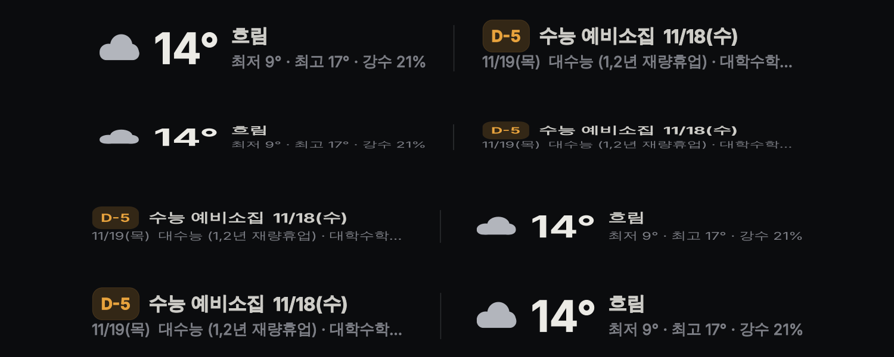

# 배정플립 1.0

배정고등학교 교육연구부에서 쓰는 **플립시계 화면보호기**입니다. Windows 10/11의 기본 .NET Framework만으로 실행되고, 따로 설치할 것이 없습니다.


## 화면 구성

| 위치 | 내용 |
|---|---|
| 가운데 | 시·분(초는 선택) 플립 카드. 숫자가 바뀔 때 카드가 위아래로 넘어감 |
| 시계 아래 | 년·월·일·요일 카드 |
| 시계 위 | **날씨**(기온·하늘·최저/최고·강수확률)와 **학사일정**(오늘 일정 또는 가장 가까운 일정과 D-day, 다가오는 일정을 한 건씩 넘김) |
| 날짜 아래 | **급식**: 점심과 저녁을 번갈아 넘기며 표시 |
| 모서리 | 학교 이름과 부서 이름 |

<p>
  
</p>

## 번인(화면 자국) 방지

- 시계 전체가 1분마다 조금씩 위치를 옮깁니다.
- 학교·부서 문구는 10분마다 다른 모서리로 옮겨 갑니다.
- 날씨와 학사일정은 10분마다 좌우 자리를 맞바꿉니다. 모서리 문구와 5분 어긋나게 바뀝니다.



## 설치

1. [Releases](../../releases)에서 `BaejeongFlip-1.0.zip`을 받아 압축을 풉니다.
2. `설치하기.bat`를 더블클릭하고, 대기 시간(분)을 입력합니다.
3. 관리자 권한은 필요 없습니다. `%LOCALAPPDATA%\BaejeongFlip`에 설치되고 바로 화면보호기로 지정됩니다.

"Windows의 PC 보호" 창이 뜨면 **추가 정보** → **실행**을 누르세요. 코드 서명이 없는 프로그램이라 나오는 경고입니다.

제거는 `제거하기.bat`를 실행하면 됩니다.

## 설정

Windows 화면보호기 설정 → **설정** 버튼에서 바꿉니다.

- **시계:** 24시간 형식, 초 표시(기본 꺼짐), 날짜·요일 표시
- **모서리 문구:** 학교·부서 이름 (비우면 숨김)
- **학사일정·급식:** NEIS 교육정보 개방 포털. 교육청 코드 `C10`, 학교 코드 `7150136`이 기본값. 일정 넘김 간격(5/8/15/30초)과 넘김 속도(0.25~1.6초)
- **날씨:** Open-Meteo(인증키 없음) 또는 기상청 단기예보(공공데이터포털 인증키). 위치는 위도·경도로 지정
- **지금 가져와 보기:** 설정대로 정보를 바로 받아 보고 결과나 오류를 보여 줌

## 인증키 보안

인증키는 **소스 코드와 이 저장소에 들어 있지 않습니다.**

- 설정 창의 인증키 칸은 저장된 키를 보여 주지 않습니다. 새 키를 입력하면 교체되고, 비워 두면 저장된 키를 그대로 씁니다. **지우기** 버튼으로 삭제할 수 있습니다.
- 키는 Windows 사용자 계정 암호화(DPAPI)로 레지스트리 `HKCU\Software\BaejeongFlip`에 저장됩니다. 다른 사용자 계정이나 다른 PC에서는 풀 수 없습니다.
- 여러 PC에 같은 키를 넣으려면 설치 zip에 `neis-key.txt`(키 한 줄)를 함께 넣으세요. 처음 실행할 때 읽어서 암호화 저장하고, 파일은 자동으로 지웁니다. `neis-key.txt`는 `.gitignore`에 들어 있어 저장소에 올라가지 않습니다.

## 정보를 받는 방식

- 화면보호기가 켜져 있을 때만 백그라운드에서 받습니다. 날씨는 30분마다, 학교 정보는 3시간마다 받습니다.
- 받은 정보는 `%LOCALAPPDATA%\BaejeongFlip\info-cache.json`에 저장되어, 인터넷이 끊겨도 마지막 정보를 보여 줍니다. 날씨는 6시간이 지나면 숨깁니다.
- NEIS 인증키가 없으면 한 번에 5건까지만 받을 수 있어서 기간을 나눠 받습니다. 일정이 많은 달에는 일부가 빠질 수 있습니다.

## 빌드

| 환경 | 방법 |
|---|---|
| Windows | `build.bat` 실행 (Windows에 기본으로 있는 .NET Framework 4 컴파일러 사용) |
| Linux (Mono) | `./build.sh zip` (.NET Framework 4.8 참조 어셈블리를 받아 그 기준으로 컴파일) |

결과물은 `release/` 폴더에 생깁니다. 이 폴더에 `neis-key.txt`가 있으면 `./build.sh zip`이 설치 zip에 함께 넣습니다.

Linux에서 빌드할 때는 Mono 자체 라이브러리가 아니라 반드시 .NET Framework 4.8 참조 어셈블리로 컴파일해야 합니다. Mono에만 있는 메서드가 섞이면 Windows에서 "메서드를 찾을 수 없습니다" 오류가 납니다.

## 파일 구성

```
src/BaejeongFlip.cs   화면 그리기, 화면보호기 창, 설정 창, 설치/제거 명령
src/Info.cs           학사일정·급식(NEIS), 날씨(Open-Meteo, 기상청) 받아 오기와 저장
installer/            설치하기.bat, 제거하기.bat, 설치방법.txt (Windows 한글 CP949)
docs/screenshots/     화면 예시
```

## 명령줄 옵션

| 옵션 | 동작 |
|---|---|
| `/s` | 화면보호기 실행 (모든 모니터) |
| `/c` | 설정 창 |
| `/p <hwnd>` | 화면보호기 설정 창의 미리보기 |
| `/install <초>` | 이 파일을 화면보호기로 지정하고 대기 시간 설정 |
| `/uninstall` | 화면보호기 지정 해제와 설정 삭제 |
| `/fetch [all]` | 정보를 받아 결과를 콘솔에 출력 (진단용) |
