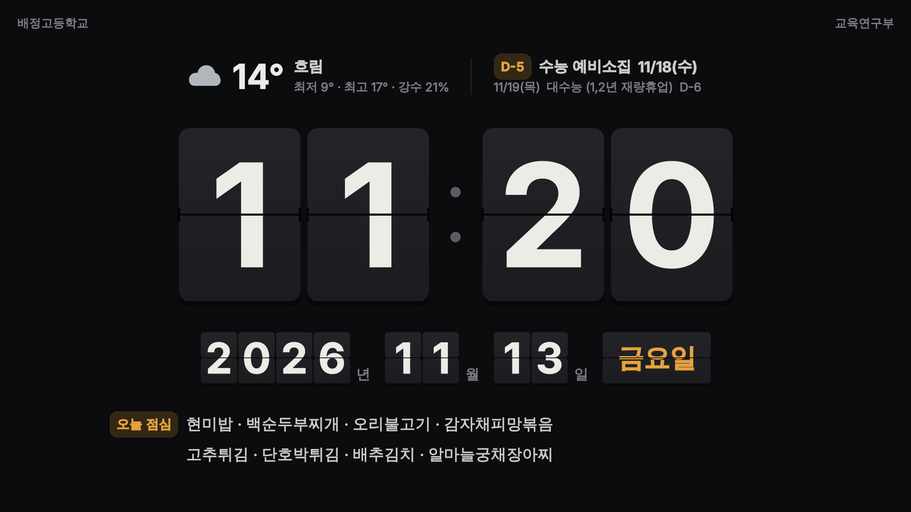
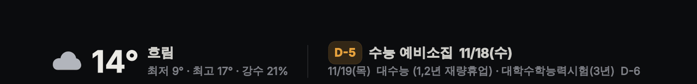
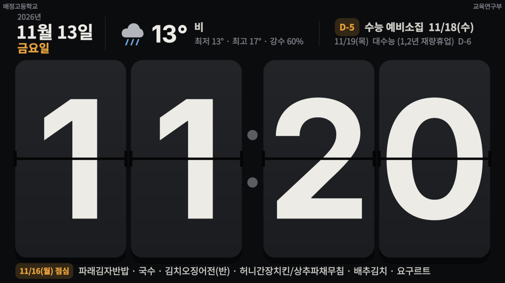
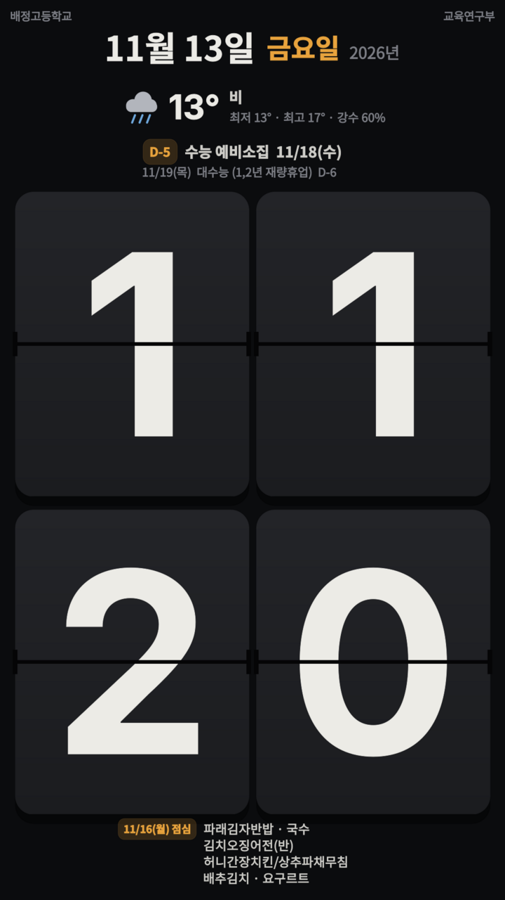
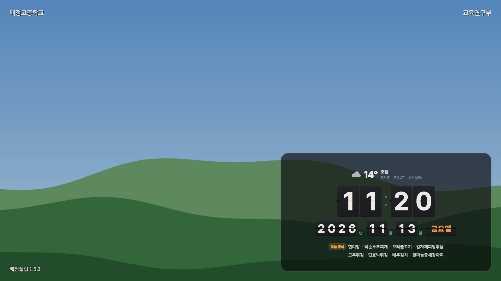

# 배정플립

배정고등학교 교육연구부에서 쓰는 **플립시계 화면보호기**입니다. Windows 10/11의 기본 .NET Framework만으로 실행되고, 따로 설치할 것이 없습니다.



> **다른 학교에서 쓰려면** → [우리 학교에서 쓰기 안내](docs/다른학교-사용안내.md)를 보세요. 설치, 인증키 받기, 학교 코드 찾기까지 순서대로 정리되어 있습니다.

## 화면 구성

| 위치 | 내용 |
|---|---|
| 가운데 | 시·분(초는 선택) 플립 카드. 숫자가 바뀔 때 카드가 위아래로 넘어감 |
| 시계 아래 | 년·월·일·요일 카드 |
| 시계 위 | **날씨**(기온·하늘·최저/최고·강수확률)와 **학사일정**(오늘 일정 또는 가장 가까운 일정과 D-day, 다가오는 일정을 한 건씩 넘김) |
| 날짜 아래 | **급식**: 점심과 저녁을 번갈아 넘기며 표시 |
| 모서리 | 학교 이름과 부서 이름 |

<p>
  
</p>

## 시계 중심 화면 (멀리서 보기)

설정 창의 **화면 크기**를 "시계 중심 화면"으로 고르면, 플립시계가 화면 높이의 약 70%를 차지합니다. 복도나 교실 앞 화면처럼 멀리서 볼 때 씁니다.

- **가로 화면:** 맨 위 모서리 문구 / 위 띠 [날짜 | 날씨 | 일정] / 큰 시계 한 줄 / 시계 아래 급식
- **세로 화면:** 모서리 문구 / 날짜 / 날씨 / 일정 / 시계 두 줄(위에 시, 아래에 분) / 급식
- **카드 비율은 화면에 맞춰 자동:** 시계가 높이 70%가 되는 선에서 카드를 가능한 한 넓게 합니다. 16:9에서는 가로:세로 약 0.56:1입니다. 4:3처럼 화면이 정사각형에 가까우면 카드가 너무 좁아지지 않도록 시계를 높이의 약 64%로 줄입니다.
- 모니터마다 가로·세로를 자동으로 판단합니다. 학교·부서 문구는 위쪽 두 모서리만 쓰며 10분마다 좌우를 바꿉니다.
- 사진 배경 모드에서는 적용되지 않습니다(시계 판 크기는 배경 설정에서 고릅니다).

| 가로 | 세로 |
|---|---|
|  |  |

## 사진 배경 모드

설정 창의 **배경**에서 "사진 배경 + 모서리에 작은 시계 판"을 고르고 사진 폴더를 지정하면, 사진을 화면 가득 깔고 시계는 반투명 판에 작게 표시합니다.

- 사진은 무작위 순서로, 정해진 간격(10초~10분)마다 천천히 겹치며 바뀝니다.
- 시계 판 안에서는 날씨와 학사일정이 한 자리에서 번갈아 넘어갑니다.
- 시계 판 위치는 오른쪽 아래, 왼쪽 아래, 10분마다 번갈아(기본) 중에서 고릅니다. 크기는 작게·보통·크게.
- 휴대폰 사진의 회전 정보(EXIF)를 반영합니다. 지원 형식: JPG, PNG, BMP, GIF, TIFF
- 화면보호기가 켜져 있을 때 **← / →** 키로 이전·다음 사진으로 넘길 수 있습니다. 화면보호기는 꺼지지 않고, 자동 넘김 시간은 그때부터 다시 셉니다. 다른 키나 마우스는 화면보호기를 끕니다.
- 폴더가 없거나 사진이 없으면 검은 바탕으로 표시합니다.



## 번인(화면 자국) 방지

- 시계 전체가 1분마다 조금씩 위치를 옮깁니다.
- 학교·부서 문구는 10분마다 다른 모서리로 옮겨 갑니다.
- 날씨와 학사일정은 10분마다 좌우 자리를 맞바꿉니다. 모서리 문구와 5분 어긋나게 바뀝니다.
- 사진 배경 모드에서는 사진이 계속 바뀌고, 시계 판이 10분마다 좌우를 옮겨 다니며 1분마다 조금씩 움직입니다.


## 설치

### 설치 파일로 설치 (Setup.exe)

`BaejeongFlip-<버전>-Setup.exe`를 실행하면 설치 마법사가 뜹니다. 대기 시간을 고르면 화면보호기로 지정되고, Windows **설정 → 앱**에 "배정플립"으로 등록되어 그곳에서 제거할 수 있습니다. 관리자 권한은 필요 없습니다.

학교용 설치 파일(`BaejeongFlip-<버전>-학교용-Setup.exe`)은 NEIS 인증키가 함께 들어 있어 설치만 하면 바로 작동합니다. 인증키가 들어 있으므로 GitHub에는 올리지 않고 교내에서만 나눠 씁니다. 설치 파일은 7-Zip 같은 압축 프로그램으로 열면 안의 키 파일을 꺼낼 수 있으니, 학교 밖으로 나가지 않게 관리하세요.

설치 파일은 `./build.sh setup`으로 만듭니다(NSIS 필요). 저장소 폴더에 `neis-key.txt`나 `kma-key.txt`가 있으면 그 키를 넣은 학교용도 함께 만들어집니다.

### zip으로 설치

1. [Releases](../../releases)에서 `BaejeongFlip-<버전>.zip`을 받아 압축을 풉니다.
2. `설치하기.bat`를 더블클릭하고, 대기 시간(분)을 입력합니다.
3. 관리자 권한은 필요 없습니다. `%LOCALAPPDATA%\BaejeongFlip`에 설치되고 바로 화면보호기로 지정됩니다.

"Windows의 PC 보호" 창이 뜨면 **추가 정보** → **실행**을 누르세요. 코드 서명이 없는 프로그램이라 나오는 경고입니다.

제거는 `제거하기.bat`를 실행하면 됩니다.

## 설정

처음 설치하면 **기본 화면 + 플립시계(검은 바탕)**로 시작합니다. 학사일정·급식·날씨는 켜져 있고, 초 표시는 꺼져 있습니다.

Windows 화면보호기 설정 → **설정** 버튼에서 바꿉니다.

- **시계:** 24시간 형식, 초 표시(기본 꺼짐), 날짜·요일 표시
- **모서리 문구:** 학교·부서 이름 (비우면 숨김)
- **학사일정·급식:** NEIS 교육정보 개방 포털. 교육청 코드 `C10`, 학교 코드 `7150136`이 기본값. **학교 찾기** 버튼으로 학교 이름을 검색하면 교육청·학교 코드와 날씨 위치(시·군·구 중심 위도·경도)를 자동으로 채움. 일정 넘김 간격(5/8/15/30초)과 넘김 속도(0.25~1.6초)
- **날씨:** Open-Meteo(인증키 없음) 또는 기상청 단기예보(공공데이터포털 인증키). 위치는 위도·경도로 지정
- **지금 가져와 보기:** 설정대로 정보를 바로 받아 보고 결과나 오류를 보여 줌

## 인증키 보안

인증키는 **소스 코드와 이 저장소에 들어 있지 않습니다.**

- 설정 창의 인증키 칸은 저장된 키를 보여 주지 않습니다. 새 키를 입력하면 교체되고, 비워 두면 저장된 키를 그대로 씁니다. **지우기** 버튼으로 삭제할 수 있습니다.
- 키는 Windows 사용자 계정 암호화(DPAPI)로 레지스트리 `HKCU\Software\BaejeongFlip`에 저장됩니다. 다른 사용자 계정이나 다른 PC에서는 풀 수 없습니다.
- 여러 PC에 같은 키를 넣으려면 설치 zip에 `neis-key.txt`(NEIS 키 한 줄), `kma-key.txt`(기상청 키 한 줄)를 함께 넣으세요. 처음 실행할 때 읽어서 암호화 저장하고, 파일은 자동으로 지웁니다. 두 파일은 `.gitignore`에 들어 있어 저장소에 올라가지 않습니다.
- `kma-key.txt`가 함께 설치되면 날씨 서버를 기상청으로 설정합니다. 학교망에서 해외 서버(Open-Meteo)가 막히는 경우가 많기 때문입니다. 고른 날씨 서버가 실패하면 다른 서버로 한 번 더 시도합니다.

## 정보를 받는 방식

- 화면보호기가 켜져 있을 때만 백그라운드에서 받습니다. 날씨는 30분마다, 학교 정보는 3시간마다 받습니다.
- 받은 정보는 `%LOCALAPPDATA%\BaejeongFlip\info-cache.json`에 저장되어, 인터넷이 끊겨도 마지막 정보를 보여 줍니다. 날씨는 6시간이 지나면 숨깁니다.
- NEIS 인증키가 없으면 한 번에 5건까지만 받을 수 있어서 기간을 나눠 받습니다. 일정이 많은 달에는 일부가 빠질 수 있습니다.

## 빌드

| 환경 | 방법 |
|---|---|
| Windows | `build.bat` 실행 (Windows에 기본으로 있는 .NET Framework 4 컴파일러 사용) |
| Linux (Mono) | `./build.sh zip` (.NET Framework 4.8 참조 어셈블리를 받아 그 기준으로 컴파일) |
| 설치 파일 | `./build.sh setup` (NSIS 필요. Ubuntu: `sudo apt install nsis`) |

결과물은 `release/` 폴더에 생깁니다. 이 폴더에 `neis-key.txt`가 있으면 `./build.sh zip`이 설치 zip에 함께 넣습니다.

Linux에서 빌드할 때는 Mono 자체 라이브러리가 아니라 반드시 .NET Framework 4.8 참조 어셈블리로 컴파일해야 합니다. Mono에만 있는 메서드가 섞이면 Windows에서 "메서드를 찾을 수 없습니다" 오류가 납니다.

## 새 버전 내기 (자동 릴리스)

1. `src/BaejeongFlip.cs`에서 두 곳의 버전을 함께 올립니다.
   - `[assembly: AssemblyInformationalVersion("1.0")]`
   - `public const string AppName = "배정플립", Version = "1.0";`
   - 필요하면 `AssemblyVersion`, `AssemblyFileVersion`(예: `1.1.0.0`)도 맞춥니다.
2. `main`에 올리면 GitHub Actions(`.github/workflows/release.yml`)가 Windows에서 빌드하고, `v1.3` 같은 태그와 공개용 zip·설치 파일(Setup.exe)이 붙은 릴리스를 만듭니다.
3. 이미 같은 버전의 릴리스가 있으면 아무것도 하지 않습니다(설치 파일이 빠져 있으면 설치 파일만 만들어 붙입니다). Actions 탭에서 **릴리스** → **Run workflow**로 직접 실행할 수도 있습니다.

## 파일 구성

```
src/BaejeongFlip.cs   화면 그리기, 화면보호기 창, 설정 창, 설치/제거 명령
src/Info.cs           학사일정·급식(NEIS), 날씨(Open-Meteo, 기상청) 받아 오기와 저장
src/Photo.cs          사진 배경 슬라이드쇼 (크로스페이드, EXIF 회전)
src/Geo.cs            주소 → 위도·경도 (시·군·구 중심 좌표표, 통계청 2018 경계에서 계산)
installer/            설치하기.bat, 제거하기.bat, 설치방법.txt (Windows 한글 CP949), setup.nsi (설치 마법사)
.github/workflows/    자동 릴리스 (버전이 바뀌면 빌드·태그·릴리스)
docs/screenshots/     화면 예시
```

## 명령줄 옵션

| 옵션 | 동작 |
|---|---|
| `/s` | 화면보호기 실행 (모든 모니터) |
| `/c` | 설정 창 |
| `/p <hwnd>` | 화면보호기 설정 창의 미리보기 |
| `/install <초>` | 이 파일을 화면보호기로 지정하고 대기 시간 설정 |
| `/uninstall` | 화면보호기 지정 해제와 설정 삭제 |
| `/fetch [all]` | 정보를 받아 결과를 콘솔에 출력 (진단용) |

## 라이선스

[MIT 라이선스](LICENSE)를 따릅니다. 다른 학교에서도 자유롭게 쓰고, 고치고, 배포할 수 있습니다. 다만 저작권 표시와 라이선스 문구를 함께 남겨 주세요. 프로그램은 있는 그대로 제공되며 어떠한 보증도 하지 않습니다.

다른 학교에서 쓸 때는 설정 창에서 교육청 코드, 학교 코드, 모서리 문구, 위도·경도를 그 학교에 맞게 바꾸면 됩니다. 학교 코드는 [NEIS 교육정보 개방 포털](https://open.neis.go.kr)의 학교기본정보에서 찾을 수 있습니다.
